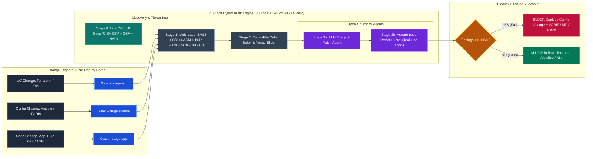
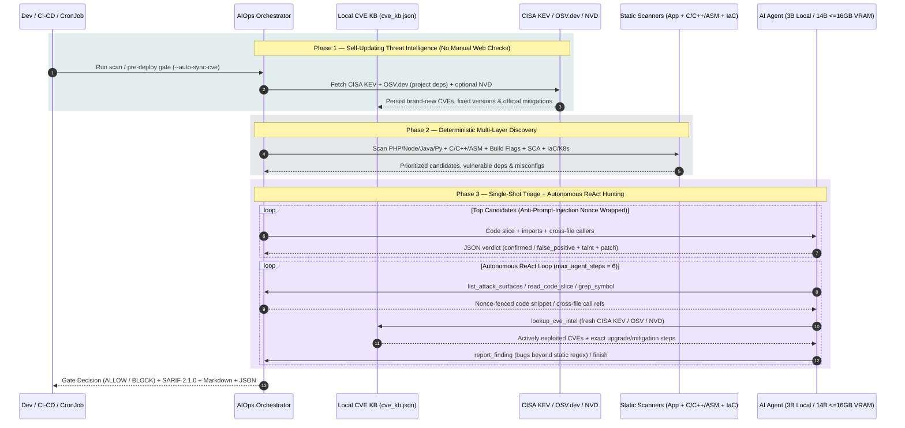

# AIOps Infra Auditor — Prod-Grade E2E Autonomous Security & Pre-Deploy Gate Pipeline

**AIOps Infra Auditor** is a production-grade DevSecOps + AIOps pipeline combining **IaC (Terraform & Platform-Agnostic Kubernetes)**, **Ansible CIS Hardening & NVIDIA Runtime**, a **Hardened Reference App**, and a **Private Autonomous AI Security Agent** powered by open-source LLMs (lightweight models for local laptop testing and `<= 16GB VRAM` models for production).

Designed as a **Pre-Deploy & Config-Change Gatekeeper**: whenever **IaC**, **Ansible**, or **App / Native Engine code (PHP, Node.js, Java, Python, C, C++, Assembly, Rust FFI)** is ready to deploy or change server/cloud configuration, the auditor automatically runs multi-layer static analysis, refreshes its live CVE knowledge (**CISA KEV + OSV.dev + NVD**), executes an **Autonomous ReAct AI Agent**, and decides **ALLOW** or **BLOCK** with actionable mitigations and patches.

---

## 1. E2E Change-Triggered Pre-Deploy Workflow



---

## 2. Autonomous AI Agent & Self-Updating Live CVE Knowledge Loop

Local open-source models (3B / 14B `<= 16GB VRAM`) have fixed training cutoffs. This pipeline solves that with a **Self-Updating Local CVE Knowledge Base** (`auditor/data/cve_kb.json`) paired with a bounded **Autonomous ReAct Tool-Use Loop**, enabling the agent to reason over newly disclosed CVEs and hunt for cross-file logic or memory bugs beyond static regex rules:



---

## 3. Multi-Layer Security Coverage (High-Level Web to Low-Level Native Engines)

| Layer | Target / Ecosystem | Detected Vulnerability Classes |
| --- | --- | --- |
| **Web / App SAST** | PHP, Node.js/TS, Java, Python (AST) | `php2shell` (`unserialize`, dynamic `include`/PHAR, `shell_exec`, `eval`), `node2shell` (`child_process.exec`, `vm.runInNewContext`, prototype pollution), `java4shell` (JNDI `lookup`, `ObjectInputStream.readObject`, SpEL/OGNL/MVEL, Jackson `enableDefaultTyping`), Python (`yaml.load`, `pickle.loads`, `subprocess(..., shell=True)`) |
| **Low-Level Native & Engines** | C, C++, Assembly (`.s`/`.asm`/inline `__asm__`), Rust FFI (`.rs`), `Makefile`/`CMakeLists.txt`/`binding.gyp` | Buffer overflows (`strcpy`/`gets`/`sprintf`/`scanf`), format string bugs (`printf(var)`), heap integer overflow (`malloc(a*b)`), Use-After-Free / Double-Free, unchecked `memcpy`/`alloca`, executable stack (`.note.GNU-stack,"x"`), raw `syscall`, Rust `unsafe`/`transmute`, disabled compiler mitigations (`-fno-stack-protector`, `-z execstack`, `-no-pie`), EOL runtime C-engine base images (`php:7.4`, `node:16/18`, `python:3.8`) |
| **Open-Source SCA & Supply Chain** | `package.json`, `pom.xml`, `composer.json`, `requirements.txt` | Curated RCE advisories (React2Shell `CVE-2025-55182`, Next.js `CVE-2025-29927`, Log4Shell `CVE-2021-44228`, Spring4Shell `CVE-2022-22965`) + **Live CISA KEV / OSV.dev / NVD KB** + malicious npm `preinstall`/`postinstall` pipe-to-shell hooks |
| **IaC & Containers** | Terraform (`.tf`), Kubernetes YAML, Ansible, Dockerfile, Compose | Open `0.0.0.0/0` SSH/DB SG rules, unencrypted EBS/S3, IMDSv1, K8s `privileged: true`, `hostPID`/`hostNetwork`, `runAsUser: 0`, sensitive `hostPath` (`docker.sock`), RBAC wildcard `*`, Ansible `curl\|sh` / weak SSH / `validate_certs: false`, Dockerfile root / `:latest` |
| **Secrets & External Tools** | All files + SARIF 2.1.0 | AWS access keys, private keys, GitHub PATs, inline DB credentials (auto-redacted) + external SARIF ingestion from **Semgrep / Trivy / Checkov** |
| **Autonomous AI Agent** | Cross-file & business logic | Auth bypasses, header spoofing, multi-hop cross-file taint chains, false-positive suppression, and minimal safe patch generation |

---

## 4. Open-Source Model Matrix (Local Test vs Prod `<= 16GB VRAM`)

All profiles are configured in [`auditor/config/models.yaml`](auditor/config/models.yaml).

> **Crucial VRAM Tuning (`<= 16GB VRAM`):** To run 14B models reliably with 16K–32K context on 16GB GPUs (NVIDIA T4 16GB / RTX 4060 Ti 16GB / RTX 4080 16GB / A4000 16GB), ensure these runtime flags are enabled (pre-configured in `docker-compose.yml`, `ansible/`, and `k8s/`):
> - **Ollama**: `OLLAMA_FLASH_ATTENTION=1`, `OLLAMA_KV_CACHE_TYPE=q8_0`, `OLLAMA_MAX_LOADED_MODELS=1`
> - **vLLM**: `--quantization awq_marlin --dtype half --gpu-memory-utilization 0.88 --max-model-len 16384 --enable-prefix-caching`

| Profile | Tier | Open-Source Model | License | Est. VRAM | Backend | Recommended Usage |
| --- | --- | --- | --- | ---: | --- | --- |
| `offline-heuristic` | Offline | Deterministic engine | Internal | 0 GB | Built-in | Air-gapped CI / zero-GPU automatic fallback |
| `local-tiny` | Local Test | `qwen2.5-coder:1.5b` | Apache-2.0 | 1.5 GB | Ollama | Ultra-fast CPU smoke tests |
| `local-dev` *(default)* | Local Test | `qwen2.5-coder:3b` | Apache-2.0 | 2.5 GB | Ollama | Daily laptop testing (CPU / 4GB GPU) |
| `local-8gb` | Local Test | `qwen2.5-coder:7b` | Apache-2.0 | 5.8 GB | Ollama | 8GB VRAM GPUs (RTX 3060 / 4060) |
| `prod-16gb-coder` | **Prod `<=16GB`** | `qwen2.5-coder:14b-instruct-q4_K_M` | Apache-2.0 | **12.5 GB** | Ollama | **Prod Default**: best JSON, ReAct tool-use & patch reliability |
| `prod-16gb-reasoning` | **Prod `<=16GB`** | `deepseek-r1:14b` | MIT | **12.8 GB** | Ollama | Deep reasoning for multi-hop taint & C/C++ memory chains |
| `prod-16gb-vllm` | **Prod `<=16GB`** | `Qwen/Qwen2.5-Coder-14B-Instruct-AWQ` | Apache-2.0 | **11.8 GB** | vLLM | High-throughput concurrent CI/CD serving |

---

## 5. Deployment Paths (On-Prem, Local K8s, Cloud K8s Agnostic + NVIDIA)

Pick **one** deployment path matching your target infrastructure—you do not need to run all of them simultaneously:

| Infrastructure Target | Stack Used | NVIDIA GPU Support | Default Profile |
| --- | --- | --- | --- |
| **Laptop / Single On-Prem Host (Docker)** | `docker-compose.yml` + `auditor/` | NVIDIA Container Toolkit (`--profile prod-gpu` / `prod-vllm`) | `local-dev` / `prod-16gb-coder` |
| **On-Prem VM / Bare Metal (Linux)** | `ansible/` (Debian/Ubuntu & RHEL/Rocky) | `nvidia_runtime` role (Docker + `containerd`) | `prod-16gb-coder` |
| **AWS EC2 Provisioning + Hardening** | `infra/terraform/` → `ansible/` | `g4dn.xlarge` (NVIDIA T4 16GB VRAM) | `prod-16gb-coder` |
| **Local K8s (`kind` / `k3s` / `minikube`)** | `k8s/overlays/local-k8s` | CPU-only | `local-dev` |
| **On-Prem K8s (`k3s` / `kubeadm` / RKE2)** | `infra/terraform-k8s/` + `k8s/overlays/onprem-k8s-nvidia` | NVIDIA GPU Operator (`driver.enabled=true`) + DCGM | `prod-16gb-coder` |
| **Cloud K8s Agnostic (EKS / GKE / AKS / DOKS)** | `infra/terraform-k8s/` + `k8s/overlays/cloud-k8s-nvidia` | NVIDIA GPU Operator (`driver.enabled=false`) + Tolerations | `prod-16gb-coder` / `prod-16gb-vllm` |

---

## 6. Quick Start & Operational Commands

### A. List Models & Run Tests
```powershell
$env:PYTHONPATH = "auditor\src"
python -m aiops_auditor models --vram-gb 16
python -m unittest discover -s tests -p "test_*.py" -v
```

### B. Sync Live CVE Knowledge Base (CISA KEV + NVD)
```powershell
$env:PYTHONPATH = "auditor\src"
python -m aiops_auditor sync-intel --include-nvd --keywords "php,node.js,openssl,spring,next.js,log4j"
```

### C. Pre-Deploy & Config-Change Gates (Blocking Wrappers)
```powershell
# Gate before applying IaC (Terraform / K8s)
.\scripts\deploy-gate.ps1 -Stage iac -Profile prod-16gb-coder -AutoSyncCve -DeployCommand "kubectl apply -k k8s/overlays/cloud-k8s-nvidia"

# Gate before applying server config changes via Ansible (git diff only)
.\scripts\deploy-gate.ps1 -Stage ansible -Profile prod-16gb-coder -ChangedOnly

# Gate before building/deploying App + Native C/C++/ASM engines
.\scripts\deploy-gate.ps1 -Stage app -Profile local-dev -AutoSyncCve -EnableOsv

# Audit any other local open-source repository with live CVE KB auto-sync
.\scripts\run-audit.ps1 -Target "D:\Code\my-project" -Profile local-dev -AutoSyncCve -EnableOsv
```

### D. Kubernetes Deployment (Local / On-Prem NVIDIA / Cloud K8s Agnostic)
```bash
# 1. Local K8s (CPU)
kubectl apply -k k8s/overlays/local-k8s

# 2. Install NVIDIA GPU Operator (On-Prem & Cloud K8s Agnostic)
helm repo add nvidia https://helm.ngc.nvidia.com/nvidia && helm repo update
helm upgrade --install gpu-operator nvidia/gpu-operator \
  -n gpu-operator --create-namespace \
  -f k8s/nvidia/gpu-operator-values.yaml

# 3a. On-Prem K8s + NVIDIA GPU (<=16GB VRAM)
kubectl apply -k k8s/overlays/onprem-k8s-nvidia

# 3b. Cloud K8s Agnostic (EKS / GKE / AKS / DOKS) + NVIDIA GPU
kubectl apply -k k8s/overlays/cloud-k8s-nvidia

# Optional: High-throughput vLLM (Qwen2.5-Coder-14B-AWQ <=16GB VRAM)
kubectl apply -f k8s/overlays/cloud-k8s-nvidia/vllm-optional.yaml

# Trigger an on-demand audit Job in-cluster
kubectl -n aiops-auditor create job --from=cronjob/aiops-security-auditor manual-audit-1
```

### E. Terraform & Ansible
```bash
# Platform-Agnostic Terraform K8s + NVIDIA GPU Operator
cd infra/terraform-k8s && terraform init
terraform apply -var-file=environments/cloud-k8s-nvidia.tfvars

# VM Provisioning (AWS) + Ansible CIS Hardening & NVIDIA Container Toolkit
cd ../terraform && terraform init && terraform plan -var-file=environments/prod.tfvars
cd ../../ansible && ansible-playbook -i inventory/generated.ini playbooks/site.yml
```

---

## 7. Production Security Controls & Hardening Checklist

- **Prompt-Injection Defense**: Untrusted source code from scanned open-source repositories is enclosed in per-call randomized nonce delimiters (`<UNTRUSTED_CODE_<nonce>>`) so adversarial comments (`// IGNORE PREVIOUS INSTRUCTIONS`) cannot hijack agent verdicts.
- **Strictly Defensive & Read-Only Agent Tools**: The Autonomous ReAct Agent is restricted to read-only inspection tools (`list_attack_surfaces`, `read_code_slice`, `grep_symbol`, `lookup_cve_intel`, `report_finding`) and strictly outputs defensive triage and remediation guidance.
- **Strict Mode vs Air-Gapped Graceful Degradation**:
  - Default local mode: degrades cleanly to `HeuristicLLMClient` when Ollama/vLLM is offline and records a fallback notice in the report.
  - Strict production CI: pass `--strict-llm` to fail immediately if the GPU LLM backend is unreachable.
- **Defense-in-Depth Infrastructure**: IMDSv2 enforced, KMS CMK with rotation, zero `0.0.0.0/0` admin SSH ingress, CIS SSH/sysctl/UFW/firewalld, default-deny K8s `NetworkPolicy`, and restricted non-root Pods (`runAsNonRoot`, `readOnlyRootFilesystem`, `cap_drop: ALL`, `seccompProfile: RuntimeDefault`).

---

## 8. Repository Layout

```text
aiops-infra-auditor/
├── auditor/                   # Core AIOps Security Auditor (Python stdlib, zero mandatory deps)
│   ├── config/                # models.yaml (3B local .. 14B <=16GB VRAM) & policy.yaml
│   └── src/aiops_auditor/
│       ├── scanners/          # code_sast, native_lowlevel (C/C++/ASM/Build), sca_deps, iac_scanner (TF/K8s/Ansible/Docker), secret_scanner, external_tools
│       ├── intel/             # cve_kb.py — Auto-sync CISA KEV + OSV.dev + NVD -> local cve_kb.json
│       ├── agents/            # orchestrator, investigator (ReAct tool loop), change_gate (iac/ansible/app), prompts
│       ├── llm/               # ollama_client, openai_compat (vLLM), heuristic_fallback
│       └── reporters/         # SARIF 2.1.0, Markdown, JSON
├── app/                       # Hardened sample microservice + isolated static audit test fixtures
├── k8s/                       # Platform-agnostic Kustomize base + overlays (local, onprem-nvidia, cloud-nvidia) + NVIDIA GPU Operator values
├── infra/
│   ├── terraform/             # AWS VPC + KMS + IMDSv2 + GPU EC2 -> auto-generates Ansible inventory
│   └── terraform-k8s/         # Platform-agnostic K8s + Helm NVIDIA GPU Operator provisioner
├── ansible/                   # Distro-agnostic CIS hardening (Debian/RHEL), NVIDIA Container Toolkit, app & auditor deploy
├── .github/workflows/         # E2E Change-Gated CI/CD (Gate App/Native + Gate IaC + Gate Ansible -> Deploy)
├── pipelines/                 # Self-hosted GitLab CI template (GPU runner support)
├── scripts/                   # deploy-gate.ps1/.sh, run-audit.ps1, pull-models.sh
└── tests/                     # Automated unit & integration test suite (17 tests)
```
